<h1 align="center">If the vulnpocalypse is the apocalypse, where are the agentic attacker hordes?</h1>

<b>The data, code and sources behind the post, by Joshua Saxe</b>

<a href="https://joshuasaxe181906.substack.com/p/if-the-vulnpocalypse-is-the-apocalypse">Read the companion Substack post</a>

  
  
  
  
  

  <a href="figures/README.md#lede-the-price-of-a-hack">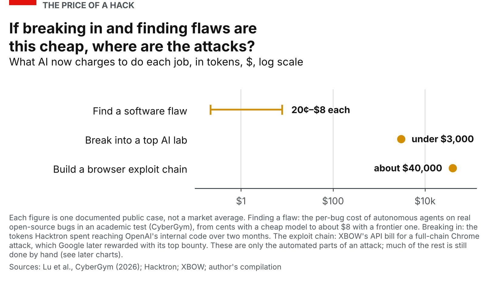</a>

The post asks why, if AI has made finding and exploiting software flaws this cheap, the attacks have not followed, and it answers with thirteen figures. This repository holds everything behind them, so that you can check a number, rerun a model, or disagree with an assumption with the evidence in front of you:

* **Data.** 20 evidence tables as plain CSV (1,627 rows), every row with a source link, a source grade and notes: [`data/`](data), with a [data dictionary](data/README.md).
* **An annotated bibliography.** 563 documents from 264 publishers, chart by chart, saying what was taken from each and which rows it fed: [`docs/BIBLIOGRAPHY.md`](docs/BIBLIOGRAPHY.md).
* **Models and chart code.** One script per figure, a Bayesian trend model for losses and seven robustness checks ([`charts/`](charts), [`models/`](models), [`sensitivity/`](sensitivity)), each described on a [model card](docs/MODELS.md).
* **The plots.** The 13 figures as PNG and SVG, with a [guide to each](figures/README.md).
* **Checks.** Numbers typed into scripts against the tables they came from, every number quoted in the methods against the results, the bibliography against the tables, and every link in the documents.

One command redraws every figure from the tables; another checks the rebuilt numbers against the ones in the post.

> **Read this first.** The tables were compiled by AI research agents from public sources and have **not been reviewed row by row**. Several figures rest on the author's judgements, and some results move noticeably if a defensible alternative is chosen. This repository says where: [what the numbers are and are not](#what-the-numbers-are-and-are-not) and [where the results are fragile](#where-the-results-are-fragile).

## The numbers in brief

Ranges are 80% intervals (10th to 90th percentile). Each row says where to look; every figure has its own entry in the [figure guide](figures/README.md).

| Figure | Finding | Number | Look at |
|---|---|---|---|
| [Lede](figures/README.md#lede-the-price-of-a-hack) | What AI charges for three automated jobs | $0.22 to $7.80 to find a flaw; under $3,000 to break into an AI lab's code; about $40,000 for a browser exploit chain | [`c00_lede_cost.json`](results/c00_lede_cost.json) |
| [1](figures/README.md#chart-1-losses-to-fraud-and-hacking-and-the-part-caused-by-ai) | How much of 2025's cybercrime losses AI caused | About $5bn ($1.5bn to $15bn) of about $300bn: 1.6% (0.5% to 4.5%); 93% chance it was under 5% | [`c01_loss_trend.json`](results/c01_loss_trend.json) |
| [2](figures/README.md#chart-2-what-happens-to-criminal-enterprises) | How criminal enterprises end | Police ended 74% (69% to 79%) of the 132 that closed, but only 46% of closed ransomware brands and 48% of darknet markets | [`c02_police.json`](results/c02_police.json) |
| [3](figures/README.md#chart-3-what-crime-pays) | What crime pays | The median dark-web developer ad, $24,000, is 9.6% of an American AI engineer's median total pay, $250,000 | [`c03_talent.json`](results/c03_talent.json) |
| [4](figures/README.md#chart-4-amdahls-law-for-a-ransomware-gang) | How far AI can speed up a ransomware gang | AI can do 39% (31% to 47%) of the hours; output per hour could rise at most 63% (44% to 89%), and about 10% (2% to 25%) by the end of 2026 | [`c04_amdahl.json`](results/c04_amdahl.json) |
| [5](figures/README.md#chart-5-how-long-abusers-keep-access-to-hosted-ai) | How long abusers keep hosted AI | Of nine operations their provider cut off, 41% (22% to 62%) went within a month and 44% (25% to 64%) lasted six months or more | [`c05_inference.json`](results/c05_inference.json) |
| [6](figures/README.md#chart-6-how-fast-criminals-adopt-new-technology) | How fast criminals adopt technology | Median lag 3.9 years for new tools (2.5 to 6.9), 5.9 for new business models (3.7 to 9.2); chance AI agents are widespread in crime by end-2029: 35% (as a business model) to 55% (as a tool) | [`c06_attacker_lag.json`](results/c06_attacker_lag.json) |
| [7](figures/README.md#chart-7-public-versus-private-pay) | Public versus private pay for AI engineers | Private firms pay 1.9 times (0.9 to 3.7) what the US state does; 2.3 in the UK, 2.6 in Israel, 8.4 in China | [`c07_pay.json`](results/c07_pay.json) |
| [8](figures/README.md#chart-8-how-far-governments-lag-business) | How far US agencies lag business | The lag fell from about nine years in 2005 to about two in 2024; AI agents mainstream in the agencies around mid-2028, a 72% chance by the end of 2029 | [`c08_govlag.json`](results/c08_govlag.json) |
| [9](figures/README.md#chart-9-how-long-state-hackers-stay-hidden) | How long state hackers stay hidden | Equation Group 14 years; a typical spying case 122 days; a typical intruder 14 days | [`c09_state_patience.json`](results/c09_state_patience.json) |
| [10](figures/README.md#chart-10-the-odds-year-by-year-that-ai-agents-become-routine) | The odds that AI agents become routine | By the end of 2029: agencies 72%; criminals 35% (business-model path) to 55% (tool path) | [`c10_odds.json`](results/c10_odds.json) |
| [11](figures/README.md#chart-11-the-defenders-build-up) | Defenders against attackers | 29 of 34 security vendors (27 to 31) shipped generative-AI features by 2026; about $20bn of defensive AI spend against about $22m offensive, roughly 900 to 1 (275 to 3,100) | [`c11_defenders.json`](results/c11_defenders.json) |
| [12](figures/README.md#chart-12-ai-found-flaws) | What happens to AI-found flaws | 516 of 6,157 reported flaws patched (8.4%); 1.3% (1.0% to 1.9%) of AI-found flaws tracked were exploited | [`c12_funnel.json`](results/c12_funnel.json) |

## The figures

<table>
  <tr>
    <td width="33%" valign="top"><a href="figures/README.md#chart-1-losses-to-fraud-and-hacking-and-the-part-caused-by-ai">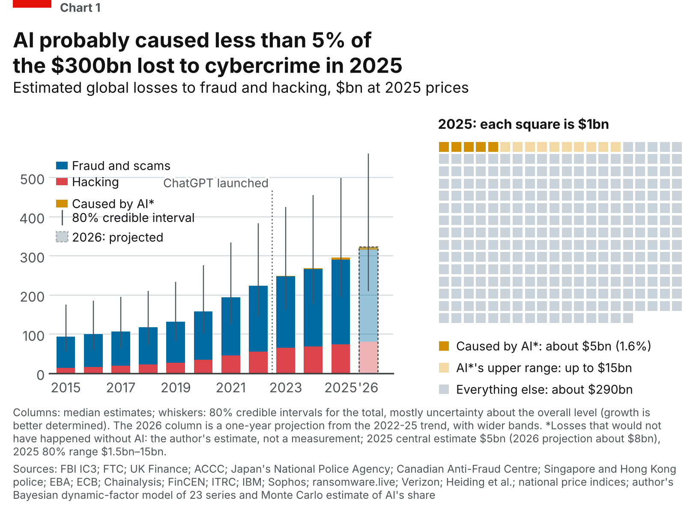</a> <b>1.</b> AI probably caused less than 5% of the $300bn lost to cybercrime in 2025</td>
    <td width="33%" valign="top"><a href="figures/README.md#chart-2-what-happens-to-criminal-enterprises">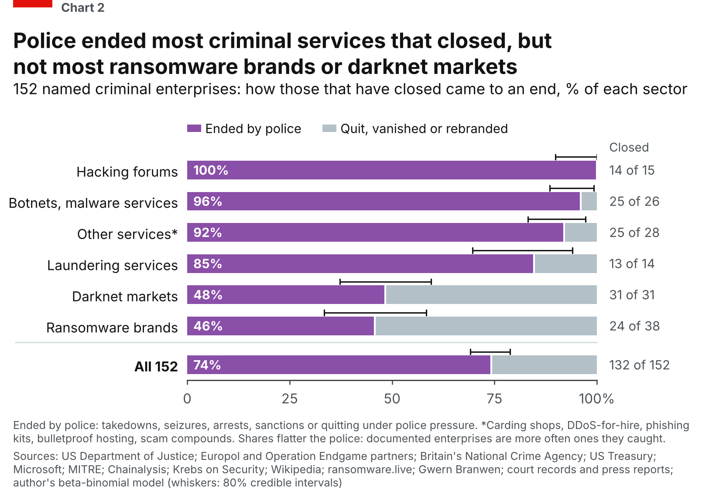</a> <b>2.</b> Police ended most criminal services that closed, but not most ransomware brands or darknet markets</td>
    <td width="33%" valign="top"><a href="figures/README.md#chart-3-what-crime-pays">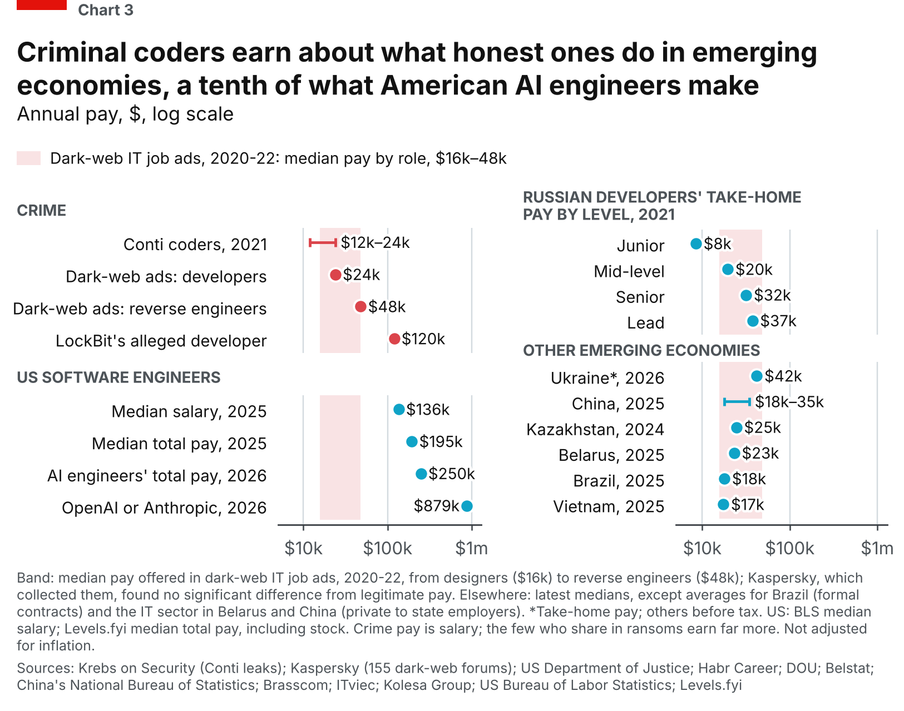</a> <b>3.</b> Criminal coders earn about what honest ones do in emerging economies, a tenth of what American AI engineers make</td>
  </tr>
  <tr>
    <td valign="top"><a href="figures/README.md#chart-4-amdahls-law-for-a-ransomware-gang">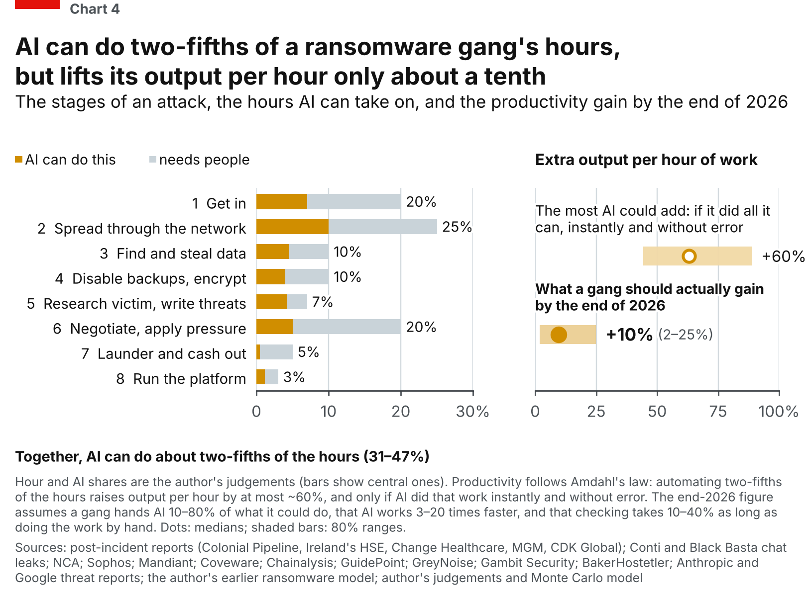</a> <b>4.</b> AI can do two-fifths of a ransomware gang's hours, but lifts its output per hour only about a tenth</td>
    <td valign="top"><a href="figures/README.md#chart-5-how-long-abusers-keep-access-to-hosted-ai">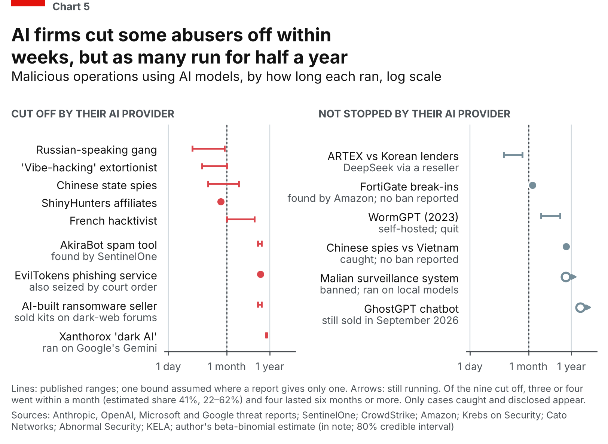</a> <b>5.</b> AI firms cut some abusers off within weeks, but as many run for half a year</td>
    <td valign="top"><a href="figures/README.md#chart-6-how-fast-criminals-adopt-new-technology">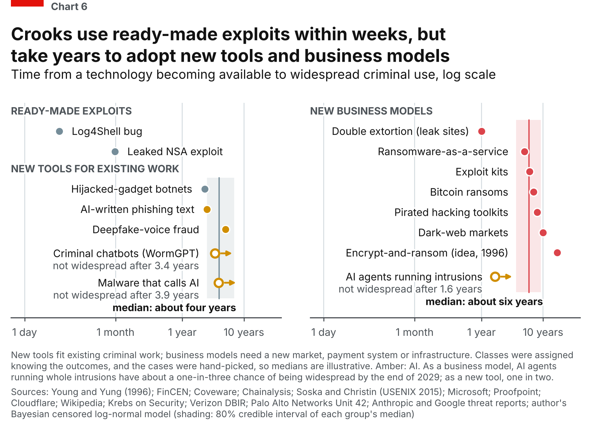</a> <b>6.</b> Crooks use ready-made exploits within weeks, but take years to adopt new tools and business models</td>
  </tr>
  <tr>
    <td valign="top"><a href="figures/README.md#chart-7-public-versus-private-pay">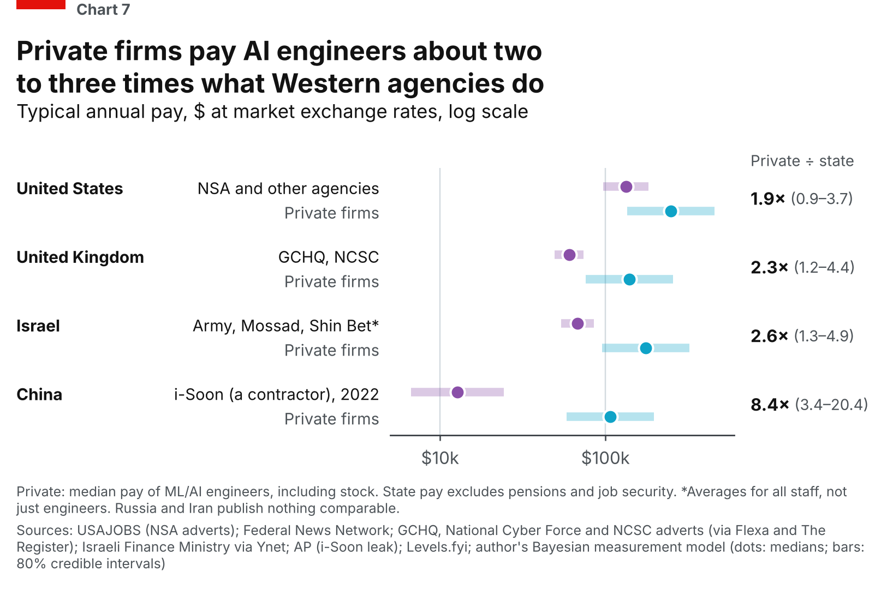</a> <b>7.</b> Private firms pay AI engineers about two to three times what Western agencies do</td>
    <td valign="top"><a href="figures/README.md#chart-8-how-far-governments-lag-business">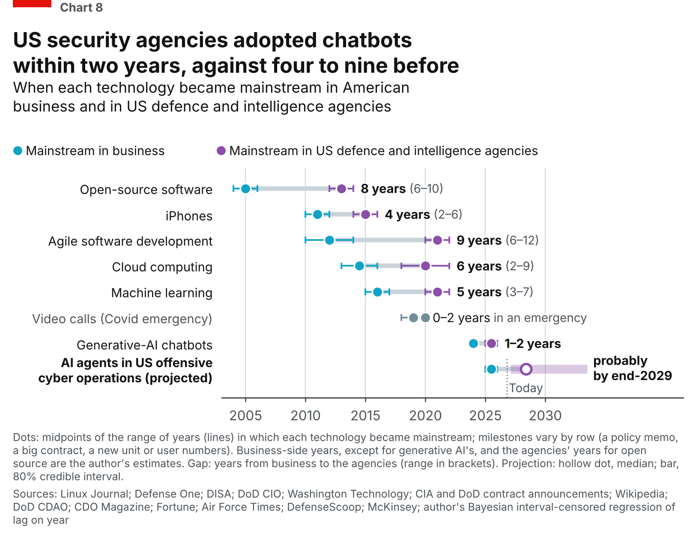</a> <b>8.</b> US security agencies adopted chatbots within two years, against four to nine before</td>
    <td valign="top"><a href="figures/README.md#chart-9-how-long-state-hackers-stay-hidden">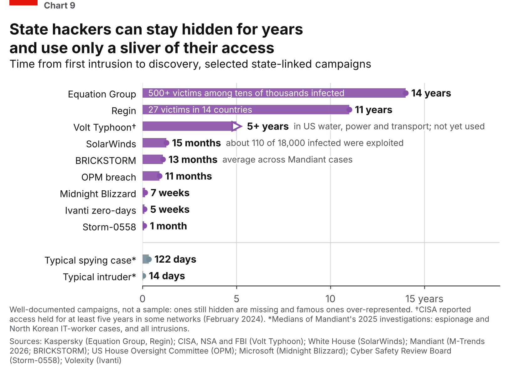</a> <b>9.</b> State hackers can stay hidden for years and use only a sliver of their access</td>
  </tr>
  <tr>
    <td valign="top"><a href="figures/README.md#chart-10-the-odds-year-by-year-that-ai-agents-become-routine">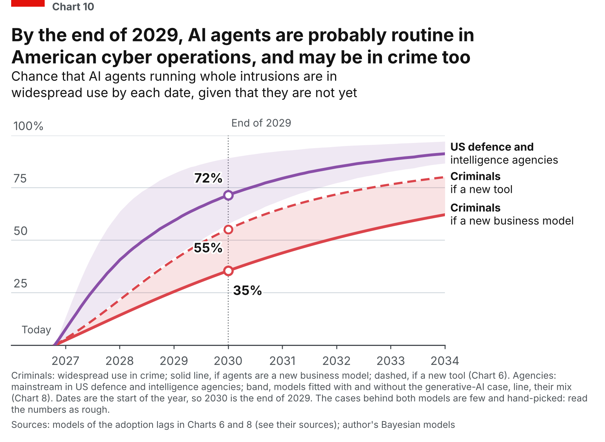</a> <b>10.</b> By the end of 2029, AI agents are probably routine in American cyber operations, and may be in crime too</td>
    <td valign="top"><a href="figures/README.md#chart-11-the-defenders-build-up">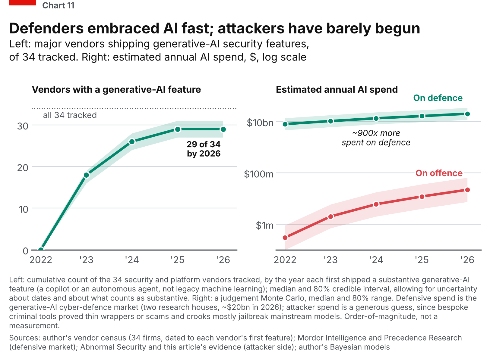</a> <b>11.</b> Defenders embraced AI fast; attackers have barely begun</td>
    <td valign="top"><a href="figures/README.md#chart-12-ai-found-flaws">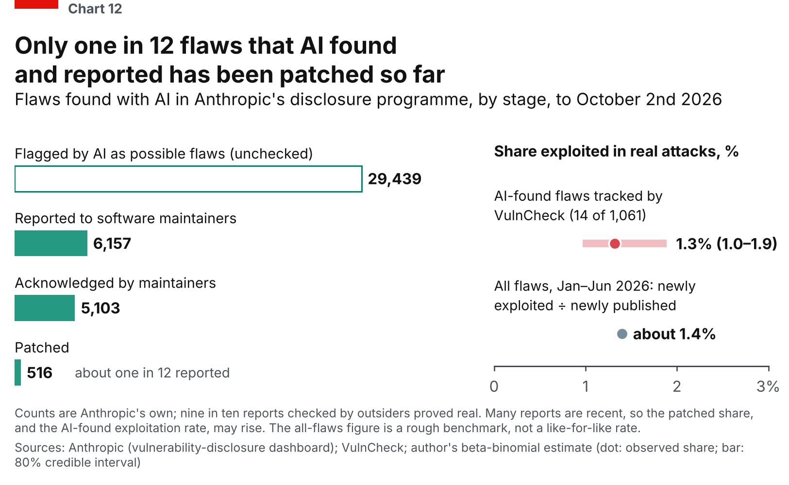</a> <b>12.</b> Only one in 12 flaws that AI found and reported has been patched so far</td>
  </tr>
</table>

## Quick start

    python3 -m venv .venv && source .venv/bin/activate
    pip install -r requirements.txt     # four packages; requirements-lock.txt pins all fourteen
    make figures                        # redraw all 13 figures from the data (about two minutes)
    make verify                         # do the rebuilt numbers match the post's? (a few seconds)

`make help` lists every target. No `make`? Run `python tools/run_all.py --figures` and `python tools/verify_numbers.py` directly. Nothing needs a network connection. Timings, and the machine they were measured on, are under [Reproducing and checking](#reproducing-and-checking).

You do not need to run anything to look: the figures are in [`figures/`](figures) (PNG and SVG), the numbers behind them in [`results/`](results) (JSON), and the data in [`data/`](data) (CSV, opens in any spreadsheet).

## A map: figure, data, method, sources

Click through from a figure to the data it reads, the model card that says how it was estimated, and the documents behind it. "Rows" are rows of the table; "documents" are distinct documents on the chart's sources page.

| Figure | Data (read by the script, unless marked as checked) | Method | Sources |
|---|---|---|---|
| [Lede](figures/README.md#lede-the-price-of-a-hack) | none (three typed costs) | none | [3 documents](docs/sources/c00_lede_cost.md) |
| [1](figures/README.md#chart-1-losses-to-fraud-and-hacking-and-the-part-caused-by-ai) | [`A1_fraud_series`](data/A1_fraud_series.csv), [`A2_hacking_series`](data/A2_hacking_series.csv), [`cpi_u`](data/cpi_u.csv); two AI-evidence tables (checked) | [Bayesian dynamic factor model](docs/MODELS.md#chart-1-losses-to-fraud-and-hacking-and-the-part-caused-by-ai) plus a judgement Monte Carlo | [214 documents](docs/sources/c01_losses.md) |
| [2](figures/README.md#chart-2-what-happens-to-criminal-enterprises) | [`B_enterprise_lifespans`](data/B_enterprise_lifespans.csv) (152 rows) | [beta-binomial; competing-risks estimate](docs/MODELS.md#chart-2-what-happens-to-criminal-enterprises) | [103 documents](docs/sources/c02_police.md) |
| [3](figures/README.md#chart-3-what-crime-pays) | [`C2_dev_pay_by_country`](data/C2_dev_pay_by_country.csv); [`C_pay`](data/C_pay.csv) and two rows of [`F_pay`](data/F_pay.csv) (checked) | [none: reported pay](docs/MODELS.md#chart-3-what-crime-pays) | [46 documents](docs/sources/c03_talent.md) |
| [4](figures/README.md#chart-4-amdahls-law-for-a-ransomware-gang) | [`E_stage_judgements`](data/E_stage_judgements.csv); [`E_stage_times`](data/E_stage_times.csv) (checked) | [Amdahl's law, judgement Monte Carlo](docs/MODELS.md#chart-4-amdahls-law-for-a-ransomware-gang) | [44 documents](docs/sources/c04_amdahl.md) |
| [5](figures/README.md#chart-5-how-long-abusers-keep-access-to-hosted-ai) | [`D_platform_cases`](data/D_platform_cases.csv) (15 of 81 rows) | [log-uniform durations; beta-binomial](docs/MODELS.md#chart-5-how-long-abusers-keep-access-to-hosted-ai) | [51 documents](docs/sources/c05_inference.md) |
| [6](figures/README.md#chart-6-how-fast-criminals-adopt-new-technology) | [`I_adoption_lags`](data/I_adoption_lags.csv) (15 of 18 rows) | [censored log-normal lags by class](docs/MODELS.md#chart-6-how-fast-criminals-adopt-new-technology) | [19 documents](docs/sources/c06_attacker_lag.md) |
| [7](figures/README.md#chart-7-public-versus-private-pay) | [`F_pay`](data/F_pay.csv) (20 of 52 rows) | [normal measurement model of log pay](docs/MODELS.md#chart-7-public-versus-private-pay) | [37 documents](docs/sources/c07_pay.md) |
| [8](figures/README.md#chart-8-how-far-governments-lag-business) | [`G_adoption`](data/G_adoption.csv) (7 of 10 rows) | [interval-censored regression](docs/MODELS.md#chart-8-how-far-governments-lag-business) | [18 documents](docs/sources/c08_govlag.md) |
| [9](figures/README.md#chart-9-how-long-state-hackers-stay-hidden) | [`H_espionage_cases`](data/H_espionage_cases.csv) (9 of 21 rows) | [none: reported dates](docs/MODELS.md#chart-9-how-long-state-hackers-stay-hidden) | [32 documents](docs/sources/c09_state_patience.md) |
| [10](figures/README.md#chart-10-the-odds-year-by-year-that-ai-agents-become-routine) | the draws saved by Charts 6 and 8 | [combines those two models](docs/MODELS.md#chart-10-the-odds-year-by-year-that-ai-agents-become-routine) | those of Charts 6 and 8 |
| [11](figures/README.md#chart-11-the-defenders-build-up) | [`G_vendor_ai`](data/G_vendor_ai.csv) (34 rows) | [vendor census Monte Carlo; spend judgements](docs/MODELS.md#chart-11-the-defenders-build-up) | [38 documents](docs/sources/c11_defenders.md) |
| [12](figures/README.md#chart-12-ai-found-flaws) | [`J_ai_vulns`](data/J_ai_vulns.csv) (12 rows; checked) | [beta-binomial](docs/MODELS.md#chart-12-ai-found-flaws) | [8 documents](docs/sources/c12_funnel.md) |

The statistics are Bayesian, in plain terms: start from a stated range of plausible values (the prior), let the evidence narrow it, and report what is left (the posterior) as a median and an 80% credible interval. Where the data cannot decide an answer, the range is the author's judgement and the figure says so. [METHODS](docs/METHODS.md) explains each figure's numbers in plain language; [MODELS](docs/MODELS.md) gives the priors, seeds and weak points of each. The code is plain numpy and scipy, with no probabilistic-programming library, so the samplers ([`common/bayes.py`](common/bayes.py), [`common/dfm.py`](common/dfm.py)) are short enough to read.

## Trace one number

The post says police ended 74% of the criminal enterprises that closed (Chart 2). To check it:

1. **Start at the figure's entry** in the [figure guide](figures/README.md#chart-2-what-happens-to-criminal-enterprises). It names the script (`charts/c02_police.py`), the table (`data/B_enterprise_lifespans.csv`) and the results file (`results/c02_police.json`, key `all`).
2. **Rebuild the number from the table**, with a few lines of Python:

       import pandas as pd
       from scipy import stats

       b = pd.read_csv("data/B_enterprise_lifespans.csv")
       ended = b[b.end_type != "still_active"]            # 132 of the 152 have closed
       by_police = ["le_takedown", "le_seizure", "le_arrests", "sanctions",
                    "rebrand_after_le_pressure"]
       k, n = int(ended.end_type.isin(by_police).sum()), len(ended)   # 98 of 132
       print(stats.beta.ppf([0.1, 0.5, 0.9], 1 + k, 1 + n - k))
       # about 0.69, 0.74, 0.79: the 74%, and its 69% to 79%

3. **Open a row.** Each of the 152 rows names an enterprise, how and when it ended, and a source with a link and a grade. Row 40, for example, is the 2014 English-language Hydra market, ended by a police seizure, source Gwern Branwen, grade B.
4. **Find the document.** [`docs/sources/c02_police.md`](docs/sources/c02_police.md) lists the 103 documents behind the chart, grouped by publisher, with the rows each one fed.
5. **Check the assumptions.** The model card says what the estimate assumes (a uniform prior on each share) and [`data/README.md`](data/README.md#how-reliable-is-this) says how far to trust the table, including the three grade-D rows that Chart 2 counts and what deleting them does (74.0% becomes 73.4%).

Every other figure can be traced the same way.

## What is where

| Folder or file | What it holds |
|---|---|
| [`data/`](data) | The 20 evidence tables (CSV), two source lists, the vendor sources page and the [data dictionary](data/README.md): what each table is, how to read a row, how far to trust it, which rows no chart uses |
| [`charts/`](charts) | One script per figure (`c00_lede_cost.py` to `c12_funnel.py`): reads `data/`, writes `results/` and `figures/` |
| [`models/`](models) | The Chart 1 loss-trend model: a Bayesian dynamic factor model fitted to 23 published loss series |
| [`common/`](common) | Shared code: the chart style kit, the Bayesian samplers, the factor model, price-index (deflator) tables and the lifespan estimators |
| [`sensitivity/`](sensitivity) | Seven robustness checks: four rerun a chart under alternative choices (Charts 1, 6, 7 and 8), three ask how many missing cases would change a conclusion (Charts 2, 5 and 9) |
| [`results/`](results) | Everything the scripts write: one JSON of numbers per figure, the robustness results and the saved posterior draws |
| [`figures/`](figures) | The 13 figures (PNG and SVG), the bundled Inter font, and the [figure guide](figures/README.md) with the colour contract |
| [`docs/`](docs) | [`BIBLIOGRAPHY.md`](docs/BIBLIOGRAPHY.md) and [`sources/`](docs/sources) (the annotated bibliography), [`MODELS.md`](docs/MODELS.md), [`METHODS.md`](docs/METHODS.md) and [`PARAMETERS.md`](docs/PARAMETERS.md) (every judgement and typed number) |
| [`tools/`](tools) | `run_all.py` (rebuild), `verify_numbers.py`, `check_inputs.py`, `build_bibliography.py` and `check_links.py` (the checks) |
| [`tests/`](tests) | The reference numbers the checks compare with, and the ledger of the 186 numbers quoted in the methods |
| [`scripts/`](scripts) | `publish.sh`, to put a copy of this folder on GitHub (see [`scripts/README.md`](scripts/README.md)) |

## What the numbers are, and are not

* **Estimates, not measurements.** No one measures global cybercrime losses, the hours a gang spends on each stage of an attack, or when AI agents will be routine. The figures turn scattered evidence and stated judgements into ranges. They are as good as both.
* **Judgements are named and listed.** A number that is the author's judgement, or was typed from a source outside the tables, is a named constant in its script. [PARAMETERS](docs/PARAMETERS.md) lists each with its range and where it came from, starting with the choices that move the answers most, and `tools/check_inputs.py` confirms each typed number against the table that holds it.
* **Small, hand-picked sets.** Charts 6, 8 and 9 rest on a few cases, chosen because they are documented. They show what is possible, not what is typical. Chart 6's classes (tools, business models, exploits) were assigned knowing the outcomes.
* **Only what was caught.** Charts 2, 5 and 9 can count only enterprises, operations and campaigns that were caught and made public. That probably flatters police in Chart 2. In Chart 9 hidden campaigns can only add long ones, and in Chart 5 hidden long cases do the same, but quick bans that no report mentions push the other way. Three checks in [`sensitivity/`](sensitivity) say how many missing cases it would take to change each conclusion; the results are [below](#where-the-results-are-fragile).
* **The newest evidence is the thinnest.** The rows on AI misuse and AI-found flaws are mostly AI labs and security vendors describing their own detections, with no outside check and no denominator.
* **The data were compiled by AI research agents** from public web sources in October 2026, under a brief to open every page, prefer primary sources, grade each data point and never invent a number, date or source. They were not reviewed row by row by a human or an independent party, and not every link has been re-fetched. Each source has a grade (A official record, B peer-reviewed or a reputable report that states its method, C a vendor or press report with a thin method, D rumour or recalled dates, E unverified), and [the data dictionary](data/README.md#how-reliable-is-this) lists the rows that carry a warning.
* **Some numbers cannot be rebuilt from here.** The research behind the post also produced text-only tables that back sentences in its text; they are not included, and the numbers that came from them cannot be reproduced from this repository ([data dictionary](data/README.md#what-is-not-here)).

## Where the results are fragile

The robustness checks in [`sensitivity/`](sensitivity), tabulated on the [model cards](docs/MODELS.md#robustness-checks), rerun a figure under a defensible alternative choice. They do not say the post's choice was wrong; they show how much a number depends on it. The checks for Charts 2, 5 and 9 were added after the post was published.

* **Chart 1: the slowdown in fraud growth.** In the base case fraud losses grew about 14% a year in 2017 to 2022 and about 9% in 2022 to 2025; hacking about 23% then 10%. Hacking slows by at least ten points in every variant tried. Fraud slows by 4 to 9 points in four variants, but by almost nothing (11.1% then 10.7%) if each series may drift by a point a year relative to the others. The 2025 levels (about $222bn for fraud and $74bn for hacking) are set by a triangulation in the author's earlier study, not by the trend, and barely move; the AI share is built from complaint data and judgement.
* **Chart 2: how many missing closures would flip "police ended most".** Police ended 98 of the 132 enterprises that closed (74%), counting only those that were documented. If police endings are twice as likely as other closures to be documented, the share is 59% (53-65%); police stop being the majority at about 2.9 times, when the table would be missing at least 64 other closures, a third of all closures, and a reading of "a large majority" as two-thirds is lost at about 1.4 times. The data cannot say what the gap is. At least 27 of the 98 police endings share one of nine end dates with another (coordinated takedowns), which the intervals treat as independent; counting each such day once, the share is 70% and the tipping point about 2.4 times. For darknet markets (15 of 31) and ransomware brands (11 of 24) the data say about half, not less than half: one or two rows classified differently would put police on the other side, and 14 of the 38 ransomware brands are still running.
* **Chart 5: the ratio of quick to slow cut-offs is fragile, and the nine cases measure different things.** Hidden quick catches (bans within a month that no report mentions) are what could overturn the chart: two would make most cut-offs quick and five would make them twice as common as long ones, while hidden long cases can only add to the long end. So "as many run for half a year as are cut off within weeks" describes nine cases and does not estimate a ratio, and "a quarter ran six months or more" holds at the median until eight quick catches are hidden but has no margin at the low end of its interval. Of the three that are certainly within a month, one is a reporting window, one is how long some network addresses were active and one is how long a stolen key was used; leaving those three out moves the shares from 41% within a month and 44% for six months or more to 17% and 62%, and leaving out instead the three long cases that were not Anthropic's moves them to 58% and 23%. The chart also says nothing about how often providers catch abuse: for half of all operations to be cut off before day 180 they would have to catch 89% of them.
* **Chart 9: "years" is an existence claim; the "sliver" is loose for one of two cases.** Hidden campaigns can only add long cases, so they cannot weaken "can stay hidden for years"; it would fail only if the long cases were overstated by 2.5 times (Volt Typhoon, a lower bound) to seven (Equation Group), and the two longest cases are both Kaspersky's, dated from its reading of the malware. Two of the nine plotted years are not what the table's own dates give (Volt Typhoon's five years is CISA's figure for some victims, and BRICKSTORM's 1.08 is Mandiant's average per victim); on the table's own dates the median is 0.9 years against Mandiant's 122 days, so the nine are not typical, which is why the chart says "can". The share worked is 0.6% for SolarWinds, which would need a 16-fold undercount to reach one in ten, and 2.5-5% for Equation Group, which would need a two- to four-fold one.
* **Charts 6 and 10: how one case is dated.** The tool path (a 55% chance that AI agents are widespread in crime by the end of 2029) dates the hijacked-gadget botnet case from the arrival of cheap insecure gadgets, about 2014. Dating it from the first Mirai sighting instead moves the tool median from 3.9 to 2.5 years and the chance to 34%. For the business-model path, 35% becomes 21% under the original classification of cases and 41% if encrypt-and-ransom is dated from 2006.
* **Charts 8 and 10: the trend in the government lag.** The fall in the lag from about nine years to about two rests heavily on the generative-AI chatbot row: without it the fitted lag falls from about seven years to about four. If the agencies' open-source adoption is dated 2009 to 2011 instead, the fit without that row no longer shows a shrinking lag (chance of shrinking 45%), and the chance that agents are routine in the agencies by the end of 2029 falls from 72% to 55%. The 72% pools the two fits (with and without that row) with equal weight and then keeps only the draws in which agents are not yet routine, which leaves about 44% of the weight on the fit with all rows and 56% on the fit without it.
* **Chart 7: Israel.** The state side for Israel is an average for all staff across several services. Counting Mossad and Shin Bet alone, the ratio is 1.7 rather than 2.6.
* **Chart 4: everything is judgement.** The hour shares and the shares AI can do are the author's ranges, informed by incident timelines, leaked chats and vendor statistics. The end-2026 gain also depends on three wide inputs: how much of what AI could do a gang hands to it, how much faster AI is, and how long checking takes.
* **Chart 11, right panel.** A judgement Monte Carlo: an order of magnitude, not a measurement. The defensive figure is a market-research estimate; the attacker figure is a deliberately generous guess.
* **Typed numbers and hand-entered tables.** A few numbers are typed from sources that are not in a table (for example the Chart 1 level, the lede costs), and the price indices for non-US pay are entered by hand. [PARAMETERS](docs/PARAMETERS.md) lists them.

## Reproducing and checking

    make figures        # the 13 figures, reusing the saved Chart 1 model fit        (about 2 minutes)
    make all            # refit the Chart 1 model first, then the 13 figures         (about 2 minutes)
    make sensitivity    # the seven robustness checks                                (about 6 minutes)
    make verify         # the checks below                                           (a few seconds)

* **`tools/verify_numbers.py`** compares what the scripts wrote with a snapshot of the numbers behind the post ([`tests/reference_numbers.json`](tests/reference_numbers.json)), then compares the 186 numbers quoted in the methods ([`tests/appendix_a_numbers.csv`](tests/appendix_a_numbers.csv): one row per number, naming the file and key it comes from and how it was rounded) with the results, and recomputes numbers quoted from the data tables. Each line is labelled IDENTICAL, CONSISTENT (different, but inside a stated tolerance, with the reason) or DIFFERENT, and DIFFERENT makes it exit with an error.
* **`tools/check_inputs.py`** takes each number typed into a chart script (the list is in the script) and says whether it matches the data table (MATCH), follows from it by arithmetic (DERIVED), is a rounding of it (APPROX), is an assumption where the table gives one bound or none (ASSUMED), is a deliberate override, or comes from outside the tables (NOT IN DATA). A typed number that contradicts its table is a FAIL.
* **`tools/build_bibliography.py --check`** fails if the bibliography and `data/sources.csv` are out of date with the tables.
* **`tools/check_links.py`** fails if any relative link or image in the Markdown files is broken.

**Determinism.** Every random draw is seeded (the seeds are on the [model cards](docs/MODELS.md#at-a-glance)), no file carries a timestamp, and the SVG files use a fixed hash salt, because matplotlib otherwise gives their elements random ids. The author tested this by rebuilding everything in a fresh virtual environment made with `pip install -r requirements.txt`: the 13 PNG and 13 SVG figures, the 20 results files and the 3 files of saved draws came out byte for byte the same as the ones in this repository, and the figures did again when the scripts ran one after another instead of two at a time. That was one machine (Linux, Python 3.13, two cores). On another machine or with other package versions the numbers should agree to within Monte Carlo noise, possibly with different last digits; `make verify` says what moved and by how much.

**Versions.** The code was written and run with Python 3.13. [`requirements.txt`](requirements.txt) pins the four packages that matter, and [`requirements-lock.txt`](requirements-lock.txt) pins all fourteen; the clean rebuild above used the first, so pip chose a newer font library (fonttools 4.68 rather than 4.67) than the lock file lists, which changed nothing in the output. The pinned numpy and scipy need Python 3.12 or newer. Other versions should work, but random streams can differ, and `make verify` then reports how far the numbers moved. The font (Inter) is bundled, so text should lay out the same on other machines.

**Timings.** Measured on a two-core Linux machine with Python 3.13 and no network connection. Creating the environment and installing the packages took about 30 seconds. `make figures` took 100 seconds with two scripts at a time (the default, `JOBS=2`) and about three minutes with one (`JOBS=1`): Charts 6 and 8, the two with four-chain samplers, take about 75 seconds each, Chart 10 (which waits for both) 17 seconds, and every other chart one to six seconds. `make all` adds the Chart 1 model fit, 8 seconds. `make sensitivity` took six minutes: it reruns Charts 2, 5, 6, 7, 8 and 9 first, and the Chart 6 check alone takes four and a half; the three checks added for Charts 2, 5 and 9 take about a second each. `make verify` took 2 to 3 seconds.

## Provenance, licences and disclosure

* **Licences.** Code is MIT-licensed ([`LICENSE`](LICENSE)). The figures, documents and compiled data tables are CC BY 4.0 ([`LICENSE-CONTENT.md`](LICENSE-CONTENT.md)); the facts and sources the tables record keep their own rights, so cite the original source where you can. Third-party files and the earlier study the Chart 1 level comes from are in [`NOTICE.md`](NOTICE.md).
* **People.** The tables are about organisations, groups and public cases. A few notes name individuals as the cited government release or court record does (people indicted, arrested, convicted or sanctioned). Addresses, contact details and photographs were not collected.
* **Disclosure.** The author co-founded Security Superintelligence Labs, which sells defensive AI, and so has an interest in how AI and security are discussed. So do the AI labs and security vendors whose reports supply much of the evidence.
* **Made with AI.** The data were compiled by AI research agents, and this repository was assembled with Claude (Anthropic) from the author's working files, then rebuilt and checked in a clean environment. The author is responsible for the content.
* **Errors.** If you find one in a row, open an issue with the table, the row number and a link to the correct page.

## Citing

Saxe, J. (2026). *If the vulnpocalypse is the apocalypse, where are the agentic attacker hordes? Data, code and annotated bibliography.* See [`CITATION.cff`](CITATION.cff); GitHub's "Cite this repository" button reads it.
